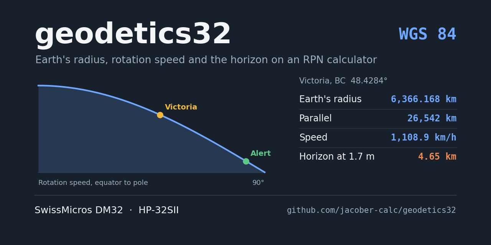
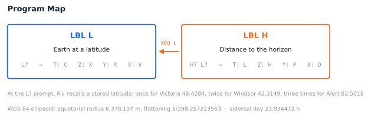
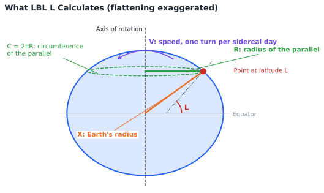
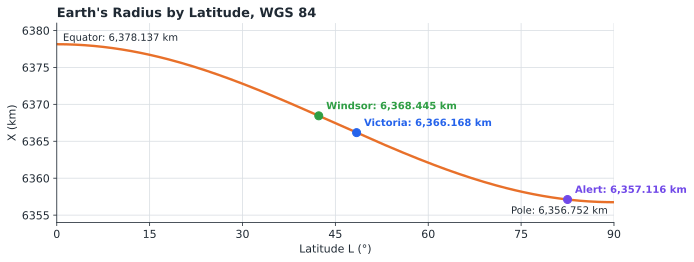
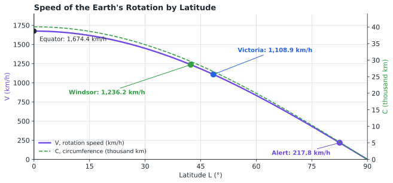
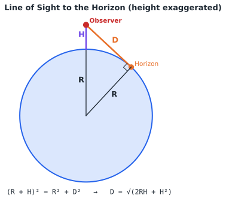
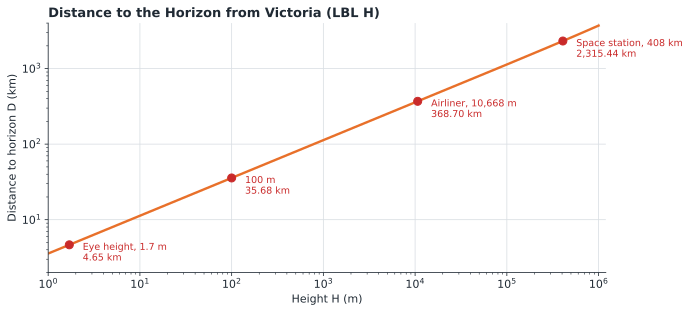

# geodetics Statefile

## TABLE OF CONTENTS

1. [Introduction](#1-introduction)
2. [Theory of Operations](#2-theory-of-operations)
3. [Variable Definitions](#3-variable-definitions)
4. [Program Descriptions](#4-program-descriptions)
5. [Operating Instructions](#5-operating-instructions)
6. [Example Calculations](#6-example-calculations)
7. [Quick Reference](#7-quick-reference)
8. [Program Listing](#8-program-listing)

---

## 1. INTRODUCTION

This program suite provides geodetic calculations for the SwissMicros DM32 calculator, based on the WGS 84 ellipsoid used by GPS. For any latitude it calculates the Earth's radius, the radius and circumference of the parallel of latitude, and the speed at which the Earth's rotation carries a point there. It also calculates the distance to the horizon from any height.

### 1.1 Purpose

The program enables users to:

- Calculate the Earth's radius at any latitude
- Calculate the radius and circumference of a parallel of latitude
- Calculate the speed of the Earth's rotation at any latitude
- Calculate the line-of-sight distance to the horizon from any height
- Express that distance as a percentage of the Earth's circumference

### 1.2 System Requirements

SwissMicros DM32 calculator with RPN operating system. Program requires 73 program steps in 2 labels. No equations, flags, Global registers, or other Statefiles are used.

Every instruction in the program is also available on the HP-32SII, so the program can be keyed into an HP-32SII as listed. The WGS 84 inverse flattening, 298.257223563, has 12 digits and fits the HP-32SII exactly.

### 1.3 Install and Download

Copy **GEODETICS.d32** to the `/STATE` folder of the DM32's internal USB disk, then load it from the calculator. Instructions are available [via the DM32 User Manual](https://technical.swissmicros.com/dm32/doc/dm32_user_manual.html#_saving_and_loading_a_state).

The Statefile is saved in FIX 6 display format and DEG angle mode. **The programs require DEG mode**: latitudes are in decimal degrees.

### 1.4 Stored Latitudes

Three latitudes are stored in the program for quick entry at the L? prompt (section 5.2):

| R↓ presses | Latitude | Place |
|------------|----------|-------|
| 1 | 48.4284 | Victoria, British Columbia |
| 2 | 42.3149 | Windsor, Ontario |
| 3 | 82.5018 | Alert, Nunavut |

---

## 2. THEORY OF OPERATIONS

### 2.1 Program Map



### 2.2 The WGS 84 Ellipsoid

The Earth's rotation makes it bulge at the equator, so it is modelled as an ellipsoid rather than a sphere. The programs use the two defining constants of WGS 84:

| Constant | Value | Program line |
|----------|-------|--------------|
| Equatorial radius, a | 6,378,137 m | L10 |
| Flattening, f | 1 ÷ 298.257223563 | L07, L08 |

The flattening is how much shorter the polar radius is than the equatorial radius, as a fraction: the polar radius is a(1 − f) = 6,356,752.314 m, about 21.4 km less.



### 2.3 Earth's Radius

LBL L calculates the distance from the Earth's centre to the surface at latitude L:

```
X = a × (1 − f × sin² L) ÷ 1000        (km)
```

This is the standard first-order formula for the radius of an ellipsoid with small flattening. It gives exactly a at the equator and a(1 − f) at the poles.



### 2.4 Parallel, Circumference, and Rotation Speed

A point at latitude L travels around the Earth's axis in a circle, the parallel of latitude. LBL L calculates its radius, its circumference, and the speed of the point:

```
R = X × cos L                (km)
C = 2πR                      (km)
V = C ÷ 23.934472            (km/h)
```

The Earth turns once relative to the stars in one **sidereal day**, 23.934472 hours (23 h 56 min 4 s), about 4 minutes shorter than the 24-hour solar day. At the equator the speed is 1,674.36 km/h; it falls to zero at the poles.



### 2.5 Distance to the Horizon

From a height H above the surface, the line of sight to the horizon touches the Earth at right angles to the radius. By Pythagoras:

```
(R + H)² = R² + D²      →      D = √(2RH + H²)
```

LBL H uses the Earth's radius at the latitude entered as R, in metres. It also expresses D as a percentage of the Earth's circumference, P = 100 × D ÷ 2πR.





### 2.6 Accuracy

- **Earth's radius (X):** within 45 m of the exact WGS 84 value at every latitude.
- **Parallel, circumference, and speed (R, C, V):** exact at the equator and slightly low elsewhere, by 0.17% at 30°, 0.37% at Victoria, and 0.66% at Alert. LBL L multiplies the Earth's radius by cos L; the exact radius of the parallel uses the ellipsoid's radius of curvature in the prime vertical, which is slightly larger away from the equator.
- **Horizon distance (D):** the straight line of sight, without atmospheric refraction. Refraction bends light around the curve of the Earth, so the visible horizon is usually somewhat farther. D is also slightly longer than the distance along the surface; the two agree to the metre at eye height, and differ by about 0.1% from an airliner and 4% from the space station.

---

## 3. VARIABLE DEFINITIONS

| Variable | Description |
|----------|-------------|
| **L** | Latitude, decimal degrees (north +, south −) |
| **F** | WGS 84 flattening, 1 ÷ 298.257223563 |
| **E** | WGS 84 equatorial radius, 6,378,137 m |
| **X** | Earth's radius at L, km |
| **R** | Radius of the parallel, km (LBL L); replaced by the Earth's radius in metres during LBL H |
| **C** | Circumference of the parallel, km |
| **V** | Speed of the Earth's rotation, km/h |
| **H** | Height above the surface, m |
| **D** | Distance to the horizon, m |
| **P** | Distance to the horizon as a percentage of the Earth's circumference |

---

## 4. PROGRAM DESCRIPTIONS

### 4.1 LBL L - Earth at a Latitude

- **Input:** Latitude (L?), keyed in or selected with R↓
- **Outputs (Stack display from top to bottom):**
  - T: Circumference of the parallel (km)
  - Z: Earth's radius (km)
  - Y: Radius of the parallel (km)
  - X: Speed of rotation (km/h)

### 4.2 LBL H - Distance to the Horizon

- **Inputs:** Height (H?) in metres, then latitude (L?)
- **Outputs (Stack display from top to bottom):**
  - T: Latitude
  - Z: Height (m)
  - Y: Distance as a percentage of the Earth's circumference
  - X: Distance to the horizon (m)

LBL H calls LBL L for the Earth's radius, so it prompts for the latitude in the same way.

---

## 5. OPERATING INSTRUCTIONS

### 5.1 Loading the Statefile

Load GEODETICS from the Available States list (`[F4]`) or the File menu (section 1.3). Check that the DEG annunciator is shown.

### 5.2 Selecting a Stored Latitude

Before the L? prompt, LBL L places the three stored latitudes on the stack (lines L02 to L05). At the prompt they sit behind the current value of L:

| Register | At the L? prompt |
|----------|------------------|
| T | 82.5018 (Alert) |
| Z | 42.3149 (Windsor) |
| Y | 48.4284 (Victoria) |
| X | Current value of L |

Press `[R↓]` once for Victoria, twice for Windsor, or three times for Alert, then `[R/S]`. To use any other latitude, key it in and press `[R/S]`.

### 5.3 Changing the Stored Latitudes

The stored latitudes are lines L03 (Alert), L04 (Windsor), and L05 (Victoria). To replace one, for example Windsor with Toronto (43.6532):

```
1. In Calculator mode press [GTO] [•] [L] 0 4      (pointer to line L04)
2. Enter Program mode and press [←]                 (delete 42.3149)
3. Key in 43.6532                                   (inserted as the new L04)
4. Leave Program mode
```

### 5.4 Earth at a Latitude

```
1. Press [XEQ] [L]
2. L? latitude, or [R↓] to select a stored one     [R/S]
```

### 5.5 Distance to the Horizon

```
1. Press [XEQ] [H]
2. H? height above the surface in metres            [R/S]
3. L? latitude, or [R↓] to select a stored one     [R/S]
```

---

## 6. EXAMPLE CALCULATIONS

Results are shown in FIX 6, the display format saved in the Statefile.

### 6.1 Victoria

**Problem:** Find the Earth's radius, the parallel, and the speed of rotation at Victoria.

**Solution:**

| Keys | Display | Description |
|------|---------|-------------|
| `[XEQ] [L]` | L?0.000000 | Prompt shows the current value of L |
| `[R↓]` | L?48.428400 | Victoria |
| `[R/S]` | 1,108.948435 | Speed of rotation, km/h |

**Results (displayed on screen from top to bottom):**

| Register | Value | Meaning |
|----------|-------|---------|
| T | 26,542.095257 | Circumference of the parallel, km |
| Z | 6,366.168117 | Earth's radius, km |
| Y | 4,224.305660 | Radius of the parallel, km |
| X | 1,108.948435 | Speed of rotation, km/h |

### 6.2 Alert

**Problem:** Repeat for Alert, Nunavut, the northernmost permanently inhabited place in the world.

**Solution:**
```
[XEQ] [L]
L?  [R↓] [R↓] [R↓]  (82.501800)  [R/S]
```

**Results:**

| Register | Value | Meaning |
|----------|-------|---------|
| T | 5,212.355860 | Circumference of the parallel, km |
| Z | 6,357.116473 | Earth's radius, km |
| Y | 829.572200 | Radius of the parallel, km |
| X | 217.776095 | Speed of rotation, km/h |

### 6.3 The Equator

**Problem:** Find the same values at the equator.

**Solution:**
```
[XEQ] [L]
L?  0 [R/S]
```

**Results:**

| Register | Value | Meaning |
|----------|-------|---------|
| T | 40,075.016686 | Circumference of the equator, km |
| Z | 6,378.137000 | Earth's radius, km (the WGS 84 equatorial radius) |
| Y | 6,378.137000 | Radius of the equator, km |
| X | 1,674.363934 | Speed of rotation, km/h |

### 6.4 Horizon at Eye Height

**Problem:** How far away is the horizon for a person whose eyes are 1.7 m above the sea at Victoria?

**Solution:**

| Keys | Display | Description |
|------|---------|-------------|
| `[XEQ] [H]` | H? | Prompt for height |
| `1.7 [R/S]` | L? | Prompt for latitude |
| `[R↓]` | L?48.428400 | Victoria |
| `[R/S]` | 4,652.415984 | Distance to the horizon, m |

**Results:**

| Register | Value | Meaning |
|----------|-------|---------|
| T | 48.428400 | Latitude |
| Z | 1.700000 | Height, m |
| Y | 0.011631 | Percent of the Earth's circumference |
| X | 4,652.415984 | Distance to the horizon, m (4.65 km) |

### 6.5 Horizon from an Airliner

**Problem:** How far is the horizon from an airliner cruising at 10,668 m (35,000 ft) over Victoria?

**Solution:**
```
[XEQ] [H]
H?  10668 [R/S]
L?  [R/S]          (keeps 48.428400)
```

**Expected Results:** D = 368,703.633236 m (368.7 km); P = 0.921763%.

### 6.6 Horizon from the Space Station

**Problem:** How far is the horizon from the International Space Station, 408 km above the Earth, passing over Victoria's latitude?

**Solution:**
```
[XEQ] [H]
H?  408000 [R/S]
L?  [R/S]          (keeps 48.428400)
```

**Expected Results:** D = 2,315,438.874856 m (2,315 km); P = 5.788624%. From the space station, the horizon is almost 6% of the way around the world.

---

## 7. QUICK REFERENCE

### 7.1 Program Summary

| Label | Function | Prompts | Output |
|-------|----------|---------|--------|
| **L** | Earth at a latitude | L | T: C (km), Z: X (km), Y: R (km), X: V (km/h) |
| **H** | Distance to the horizon | H, L | T: L, Z: H (m), Y: P (%), X: D (m) |

At the L? prompt: `[R↓]` once for Victoria, twice for Windsor, three times for Alert.

### 7.2 Important Notes

- The calculator must be in DEG mode; latitudes are in decimal degrees
- Heights are entered in metres; LBL H returns the distance in metres
- LBL L returns lengths in kilometres and speed in kilometres per hour
- At the L? prompt, press `[R↓]` before keying anything else; keying a number first replaces the current value of L, and the stored latitudes stay behind it
- Southern latitudes may be entered as negative numbers; results are the same as for the same northern latitude
- LBL H replaces R (radius of the parallel, km) with the Earth's radius in metres
- R, C, and V are slightly low away from the equator, by up to 0.66% at Alert (section 2.6)
- The horizon distance ignores atmospheric refraction and is a straight line of sight

---

## 8. PROGRAM LISTING

The complete program listing is provided below. Program steps are shown in standard DM32 RPN format with label-relative line numbers, as displayed on the calculator. The DM32 does not generate checksums.

### LBL L - Earth at a Latitude

```
L01  LBL L          Earth at a latitude.
L02  CLx            Clears X; disables stack lift.
L03  82.5018        Alert, NU: 82.5018° (to T at prompt).
L04  42.3149        Windsor, ON: 42.3149° (to Z).
L05  48.4284        Victoria, BC: 48.4284° (to Y).
L06  INPUT L        Prompts for latitude; R↓ selects a stored one.
L07  298.257223563  WGS 84 inverse flattening.
L08  1/x            Flattening f.
L09  STO F          Stored in F.
L10  6378137        WGS 84 equatorial radius, m.
L11  STO E          Stored in E.
L12  RCL L
L13  SIN            sin L.
L14  RCL L
L15  SIN
L16  ×              sin² L.
L17  RCL F
L18  ×              f·sin² L.
L19  1
L20  x<>y
L21  -              1 − f·sin² L.
L22  RCL E
L23  ×              Earth's radius at L, m.
L24  1000
L25  ÷              Converts to km.
L26  STO X          Stored in X.
L27  RCL L
L28  COS            cos L.
L29  ×              Radius of the parallel, km.
L30  STO R          Stored in R.
L31  π
L32  2
L33  ×
L34  ×              Circumference 2πR, km.
L35  STO C          Stored in C.
L36  23.934472      Sidereal day, hours.
L37  ÷              Speed of rotation, km/h.
L38  STO V          Stored in V.
L39  RCL C          T-register: circumference, km.
L40  RCL X          Z-register: Earth's radius, km.
L41  RCL R          Y-register: radius of the parallel, km.
L42  RCL V          X-register: speed, km/h.
L43  RTN            Done.
```

### LBL H - Distance to the Horizon

```
H01  LBL H          Distance to the horizon.
H02  INPUT H        Prompts for height, m.
H03  XEQ L          Prompts for latitude; Earth at L.
H04  RCL X
H05  1000
H06  ×              Earth's radius, m.
H07  STO R          Stored in R.
H08  2
H09  ×              2R.
H10  RCL H
H11  ×              2RH.
H12  RCL H
H13  x²             H².
H14  +              2RH + H².
H15  SQRT           Line-of-sight distance, m.
H16  STO D          Stored in D.
H17  RCL R
H18  2
H19  π
H20  ×
H21  ×              2πR, Earth's circumference, m.
H22  ÷              D ÷ 2πR.
H23  100
H24  ×              As a percentage.
H25  STO P          Stored in P.
H26  RCL L          T-register: latitude.
H27  RCL H          Z-register: height, m.
H28  RCL P          Y-register: percent of circumference.
H29  RCL D          X-register: distance, m.
H30  RTN            Done.
```

---

## Disclaimer

This program suite is provided as-is for educational and personal use. It uses simplified formulas and is not a substitute for survey-grade geodetic software or approved navigation equipment.

### By jacober-calc for SwissMicros DM32

> - [SwissMicros Website](https://www.swissmicros.com)
> - [DM32 product page](https://www.swissmicros.com/en/products/dm32)
> - [SwissMicros full products page](https://www.swissmicros.com/en/shop)
> - [DM32 Online User Manual](https://technical.swissmicros.com/dm32/doc/dm32_user_manual.html)
> - [SwissMicros Calculator Forum](https://forum.swissmicros.com/index.php)
